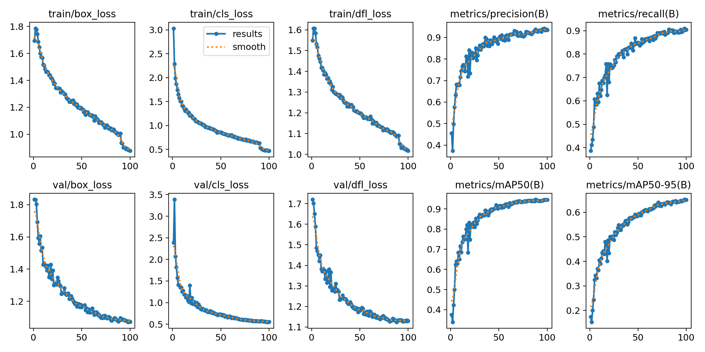
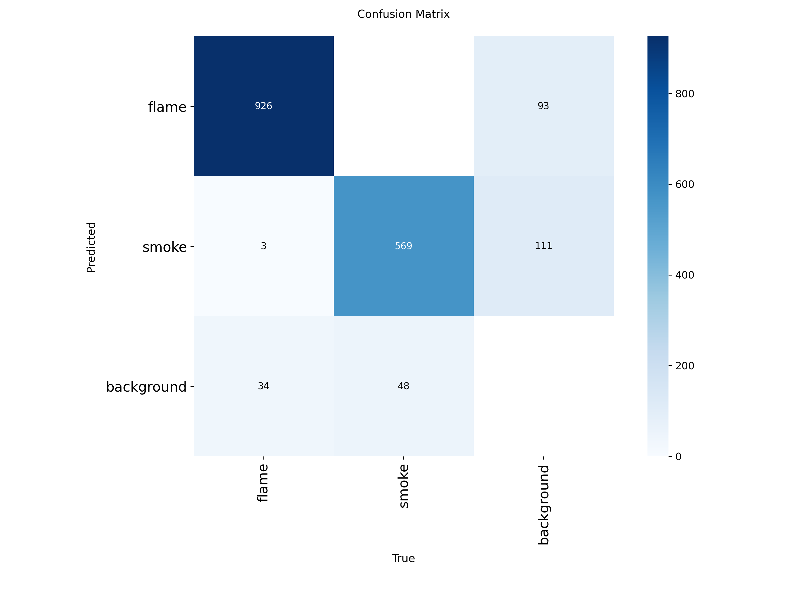
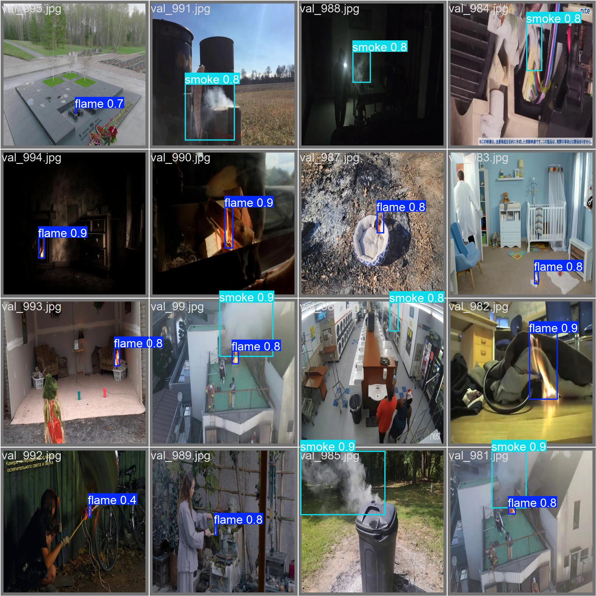

# FireDetection

Real-time flame and smoke detection with a fine-tuned YOLO11n model, plus an INT8 OpenVINO export for lighter CPU inference.

## Model and data

- **Base model:** Ultralytics `yolo11n.pt`, fine-tuned for object detection.
- **Dataset:** referenced as `data/dataset.yaml`, which is not committed. The dataset's source and license are currently undocumented.

## Training config

From [`train/args.yaml`](train/args.yaml): 100 epochs, batch 16, image size 640. The training notebook is [`main.ipynb`](main.ipynb).

## Results

Final epoch (epoch 100) metrics on the validation split, from [`train/results.csv`](train/results.csv):

| Precision | Recall | mAP50 | mAP50-95 |
|---|---|---|---|
| 0.935 | 0.904 | 0.945 | 0.651 |





## INT8 OpenVINO export

`train/weights/best_int8_openvino_model/` holds the INT8 export. The Ultralytics benchmark recorded in [`benchmarks.log`](benchmarks.log) (imgsz 640, same dataset):

| Format | Size | mAP50-95 | Inference | FPS |
|---|---|---|---|---|
| OpenVINO INT8 | 3.2 MB | 0.6367 | 13.58 ms/img | 73.61 |

The hardware used for training and benchmarking was not recorded.

## Run it

```bash
pip install -r requirements.txt   # ultralytics; uses the PyTorch cu128 index
python test.py                    # Ultralytics inference app on train/weights/best.pt
```

## Gaps

Dataset provenance, hardware, and a license still need to be documented.
